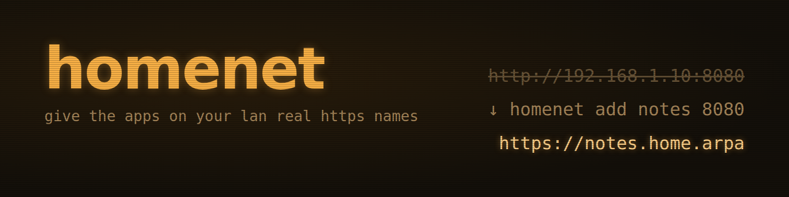

# homenet

One command gives an app on your home network an HTTPS name: `homenet add notes 8080` makes `https://notes.home.arpa` work, using your Pi-hole for DNS and Caddy as the reverse proxy.

Before, you type `http://192.168.1.10:8080` into a browser and click past a certificate warning. After, it is `https://notes.home.arpa` with a trusted cert.

```
$ homenet add notes 8080
caddy: notes.home.arpa -> 192.168.1.10:8080 (added)
dns:   notes.home.arpa -> 192.168.1.3 (added)
check: dns notes.home.arpa -> 192.168.1.3 ok
check: https notes.home.arpa -> 200 (tls trusted) ok
```

## How it stays safe

- Compare-and-set: every write checks the Caddyfile or `dns.hosts` is still what homenet read, under a lock, and retries if someone else changed it.
- Caddy validates the new Caddyfile before it is written. If the reload still fails, the previous file is put back.
- Each write keeps a timestamped backup in `/root/homenet-backups/` on that host; the last 30 are kept.
- Ownership markers: homenet only changes or removes sites between its own `# homenet:begin/end NAME` comments, and refuses names that exist anywhere else.
- Re-running `add` or `rm` finishes a half-done run and changes nothing when the state is already right.

Measured: `homenet init` took a fresh Debian box to a working setup in 1m03.8s; `add` takes 1.5s on a fresh box.

## Requirements

- Pi-hole v6 (homenet edits `dns.hosts` through `pihole-FTL --config`).
- Caddy, either installed on the host or in Docker with the Caddyfile bind-mounted at `/etc/caddy/Caddyfile`. homenet writes sites with `tls internal`.
- SSH key access as root to the Pi-hole and Caddy hosts, or run homenet as root on the machine that has them.
- On the machine running homenet: Python 3.11+, `dig` and `curl`.

Don't have Pi-hole or Caddy yet? `homenet init` can install them on a Debian host (it asks first). The check also accepts Ubuntu and other Debian derivatives, but only Debian 13 was tested.

## Install

```bash
curl -fsSL https://raw.githubusercontent.com/graydeon/homenet/main/install.sh | bash
```

Or read it first: `curl -fsSLO https://raw.githubusercontent.com/graydeon/homenet/main/install.sh`, look at it, then `bash install.sh`.
From a clone: `git clone https://github.com/graydeon/homenet && cd homenet && ./install.sh`.

Manual install: `install -m 755 homenet ~/.local/bin/homenet` (any directory on PATH works), then `homenet init`.

`init` asks where Pi-hole and Caddy live and how to reach them, checks that both answer, offers to install whichever is missing, and writes `~/.config/homenet/config.toml`. To write the config by hand instead, start from [config.example.toml](config.example.toml):

```toml
domain = "home.arpa"
default_host = "192.168.1.10"
app_ports = [8000, 8099]

[pihole]
ip = "192.168.1.2"
run = "ssh root@192.168.1.2"

[caddy]
ip = "192.168.1.3"
run = "ssh root@192.168.1.3"
caddyfile = "/etc/caddy/Caddyfile"
# docker = "caddy"
```

`domain` is your choice: `home.arpa` (reserved for home networks by RFC 8375, the default), `internal`, `lan`, anything that is valid DNS. Avoid `.local`: it belongs to mDNS and tends to break. `run` is the command that gives a root shell on that host, for example `ssh root@pve pct exec 100 --` for a Proxmox container, or empty for the local machine.

After setup, point your router's DHCP DNS setting at the Pi-hole so clients resolve the names.

## Commands

```
homenet init                   detect or install Pi-hole and Caddy, write the config
homenet list [--json]          every name in your domain and where it points
homenet check NAME             exit 0 if free, 1 if taken
homenet port                   next free port in app_ports on the default host
homenet add NAME BACKEND       BACKEND is ip:port, or a bare port on the default host
homenet add NAME BACKEND --replace   repoint a name homenet added
homenet rm NAME                remove a name homenet added
homenet verify NAME            check DNS, the HTTPS route and the backend
```

Bind your app to `0.0.0.0` or the default host's LAN address, not `127.0.0.1`, so Caddy can reach it. Exit codes: 0 working, 1 error or name taken, 3 registered but the backend is not answering (start the app, then `homenet verify`).

## Limits

- `list` sees Pi-hole `dns.hosts`, `/etc/dnsmasq.d/*.conf` and the Caddyfile's sites. A name defined anywhere else is invisible to it.
- One Pi-hole and one Caddy. Backends are IPv4 `ip:port`.
- `init` installs only on Debian-family systems; only Debian 13 was tested. Caddy in Docker must already be running.
- Tested with Caddy in Docker inside a Proxmox container reached via `ssh ... pct exec`, and with Debian's Caddy package plus Pi-hole v6 on Debian 13 (installed by hand and by `init`), reached locally and over `ssh root@`.

To get the green padlock, trust Caddy's internal root CA on each client: copy `/var/lib/caddy/.local/share/caddy/pki/authorities/local/root.crt` (in Docker: `/data/caddy/pki/authorities/local/root.crt`) from the Caddy host and add it to the device's trusted certificates.

Tests: `python3 -m unittest test_homenet` (offline).

Also by me: [sbx](https://github.com/graydeon/sbx) · [dibs](https://github.com/graydeon/dibs) · [Mousa](https://github.com/graydeon/mousa)

## License

MIT
